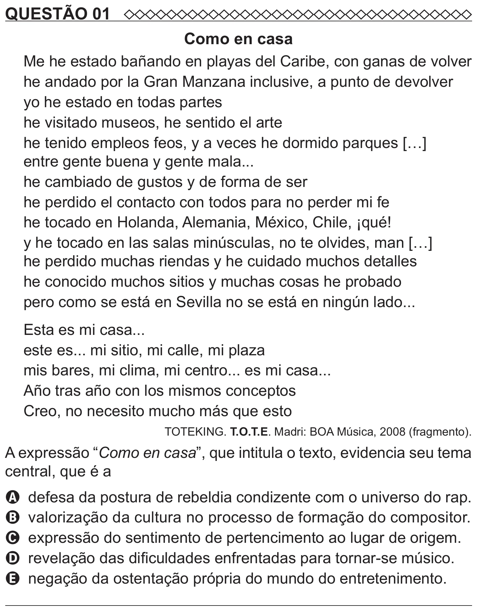

Texto extraído (pode conter ruído)

QUESTÃO 01  
Como en casa  
Me he estado bañando en playas del Caribe, con ganas de volver  
he andado por la Gran Manzana inclusive, a punto de devolver  
yo he estado en todas partes  
he visitado museos, he sentido el arte  
he tenido empleos feos, y a veces he dormido parques […]  
entre gente buena y gente mala...  
he cambiado de gustos y de forma de ser  
he perdido el contacto con todos para no perder mi fe  
he tocado en Holanda, Alemania, México, Chile, ¡qué!  
y he tocado en las salas minúsculas, no te olvides, man […]  
he perdido muchas riendas y he cuidado muchos detalles  
he conocido muchos sitios y muchas cosas he probado  
pero como se está en Sevilla no se está en ningún lado...  
Esta es mi casa...  
este es... mi sitio, mi calle, mi plaza  
mis bares, mi clima, mi centro... es mi casa...  
Año tras año con los mismos conceptos  
Creo, no necesito mucho más que esto  
TOTEKING. T.O.T.E. Madri: BOA Música, 2008 (fragmento).  
A expressão “Como en casa”, que intitula o texto, evidencia seu tema  
central, que é a  
A defesa da postura de rebeldia condizente com o universo do rap.  
B valorização da cultura no processo de formação do compositor.  
C expressão do sentimento de pertencimento ao lugar de origem.  
D revelação das dificuldades enfrentadas para tornar-se músico.  
E negação da ostentação própria do mundo do entretenimento.

