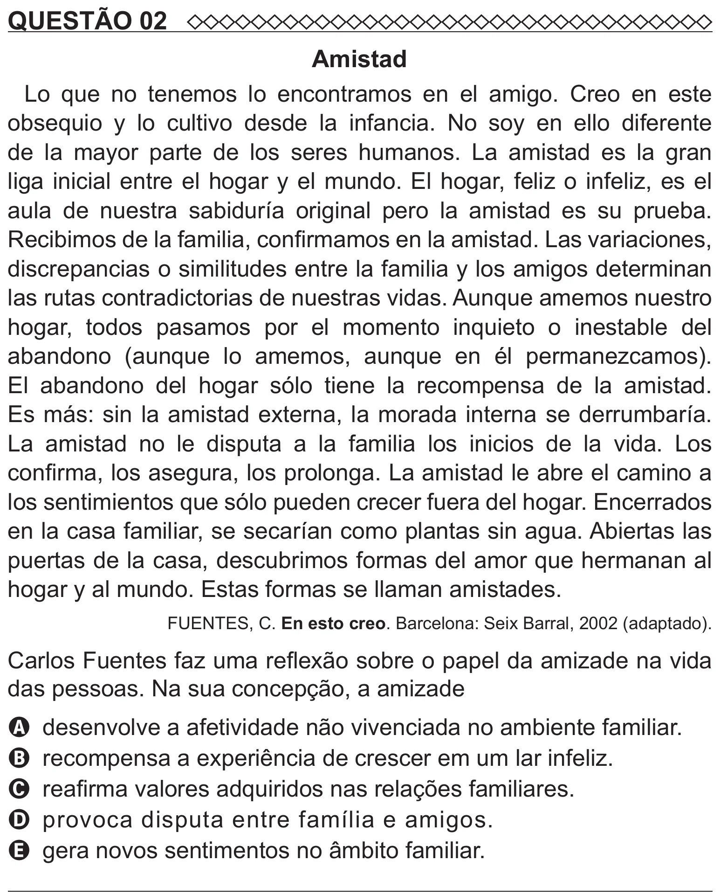

Texto extraído (pode conter ruído)

QUESTÃO 02  
Amistad  
Lo que no tenemos lo encontramos en el amigo. Creo en este  
obsequio y lo cultivo desde la infancia. No soy en ello diferente  
de la mayor parte de los seres humanos. La amistad es la gran  
liga inicial entre el hogar y el mundo. El hogar, feliz o infeliz, es el  
aula de nuestra sabiduría original pero la amistad es su prueba.  
Recibimos de la familia, confirmamos en la amistad. Las variaciones,  
discrepancias o similitudes entre la familia y los amigos determinan  
las rutas contradictorias de nuestras vidas. Aunque amemos nuestro  
hogar, todos pasamos por el momento inquieto o inestable del  
abandono (aunque lo amemos, aunque en él permanezcamos).  
El abandono del hogar sólo tiene la recompensa de la amistad.  
Es más: sin la amistad externa, la morada interna se derrumbaría.  
La amistad no le disputa a la familia los inicios de la vida. Los  
confirma, los asegura, los prolonga. La amistad le abre el camino a  
los sentimientos que sólo pueden crecer fuera del hogar. Encerrados  
en la casa familiar, se secarían como plantas sin agua. Abiertas las  
puertas de la casa, descubrimos formas del amor que hermanan al  
hogar y al mundo. Estas formas se llaman amistades.  
FUENTES, C. En esto creo. Barcelona: Seix Barral, 2002 (adaptado).  
Carlos Fuentes faz uma reflexão sobre o papel da amizade na vida  
das pessoas. Na sua concepção, a amizade  
A desenvolve a afetividade não vivenciada no ambiente familiar.  
B recompensa a experiência de crescer em um lar infeliz.  
C reafirma valores adquiridos nas relações familiares.  
D provoca disputa entre família e amigos.  
E gera novos sentimentos no âmbito familiar.

