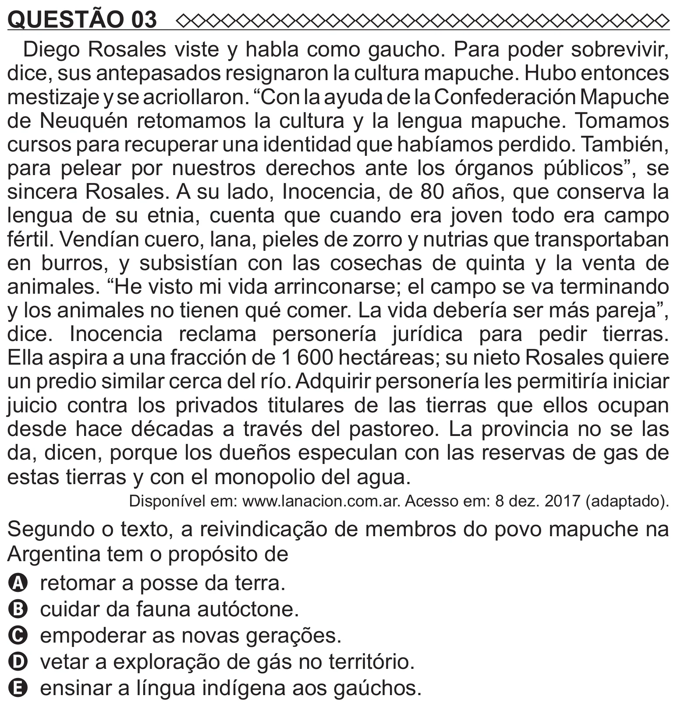

Texto extraído (pode conter ruído)

QUESTÃO 03  
Diego Rosales viste y habla como gaucho. Para poder sobrevivir,  
dice, sus antepasados resignaron la cultura mapuche. Hubo entonces  
mestizaje y se acriollaron. “Con la ayuda de la Confederación Mapuche  
de Neuquén retomamos la cultura y la lengua mapuche. Tomamos  
cursos para recuperar una identidad que habíamos perdido. También,  
para pelear por nuestros derechos ante los órganos públicos”, se  
sincera Rosales. A su lado, Inocencia, de 80 años, que conserva la  
lengua de su etnia, cuenta que cuando era joven todo era campo  
fértil. Vendían cuero, lana, pieles de zorro y nutrias que transportaban  
en burros, y subsistían con las cosechas de quinta y la venta de  
animales. “He visto mi vida arrinconarse; el campo se va terminando  
y los animales no tienen qué comer. La vida debería ser más pareja”,  
dice. Inocencia reclama personería jurídica para pedir tierras.  
Ella aspira a una fracción de 1 600 hectáreas; su nieto Rosales quiere  
un predio similar cerca del río. Adquirir personería les permitiría iniciar  
juicio contra los privados titulares de las tierras que ellos ocupan  
desde hace décadas a través del pastoreo. La provincia no se las  
da, dicen, porque los dueños especulan con las reservas de gas de  
estas tierras y con el monopolio del agua.  
Disponível em: www.lanacion.com.ar. Acesso em: 8 dez. 2017 (adaptado).  
Segundo o texto, a reivindicação de membros do povo mapuche na  
Argentina tem o propósito de  
A retomar a posse da terra.  
B cuidar da fauna autóctone.  
C empoderar as novas gerações.  
D vetar a exploração de gás no território.  
E ensinar a língua indígena aos gaúchos.

