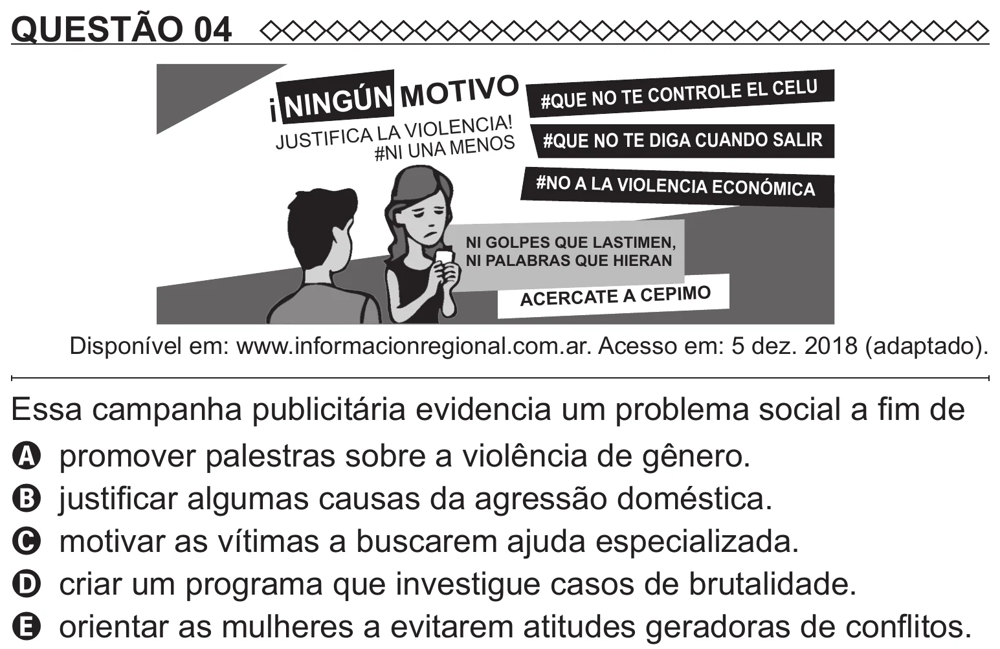

Texto extraído (pode conter ruído)

QUESTÃO 04  
TIVO  
OLE EL CELU  
N  
M  
O  
Ú  
#QUE NO TE CONTR  
i N  
I  
N  
G  
VIOLENCIA!  
A  
L  
A  
T  
IF  
IC  
#QUE NO TE DIGA CUANDO SALIR  
JU  
S  
OS  
#NI UNA MEN  
#NO A LA VIOLENCIA ECONÓMICA  
NI GOLPES QUE LASTIMEN,  
NI PALABRAS QUE HIERAN  
ACERCATE A CEPIMO  
Disponível em: www.informacionregional.com.ar. Acesso em: 5 dez. 2018 (adaptado).  
Essa campanha publicitária evidencia um problema social a fim de  
A promover palestras sobre a violência de gênero.  
B justificar algumas causas da agressão doméstica.  
C motivar as vítimas a buscarem ajuda especializada.  
D criar um programa que investigue casos de brutalidade.  
E orientar as mulheres a evitarem atitudes geradoras de conflitos.

