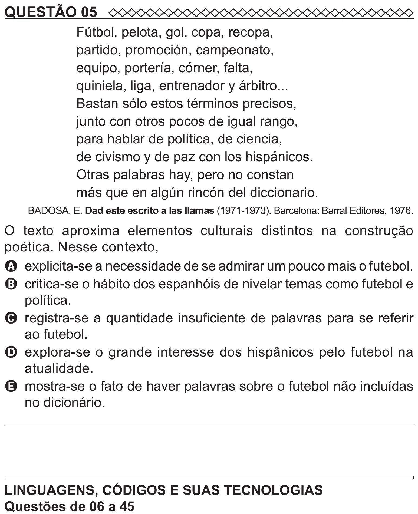

Texto extraído (pode conter ruído)

QUESTÃO 05  
Fútbol, pelota, gol, copa, recopa,  
partido, promoción, campeonato,  
equipo, portería, córner, falta,  
quiniela, liga, entrenador y árbitro...  
Bastan sólo estos términos precisos,  
junto con otros pocos de igual rango,  
para hablar de política, de ciencia,  
de civismo y de paz con los hispánicos.  
Otras palabras hay, pero no constan  
más que en algún rincón del diccionario.  
BADOSA, E. Dad este escrito a las llamas (1971-1973). Barcelona: Barral Editores, 1976.  
O texto aproxima elementos culturais distintos na construção  
poética. Nesse contexto,  
A explicita-se a necessidade de se admirar um pouco mais o futebol.  
B critica-se o hábito dos espanhóis de nivelar temas como futebol e  
política.  
C registra-se a quantidade insuficiente de palavras para se referir  
ao futebol.  
D explora-se o grande interesse dos hispânicos pelo futebol na  
atualidade.  
E mostra-se o fato de haver palavras sobre o futebol não incluídas  
no dicionário.  
LINGUAGENS, CÓDIGOS E SUAS TECNOLOGIAS

