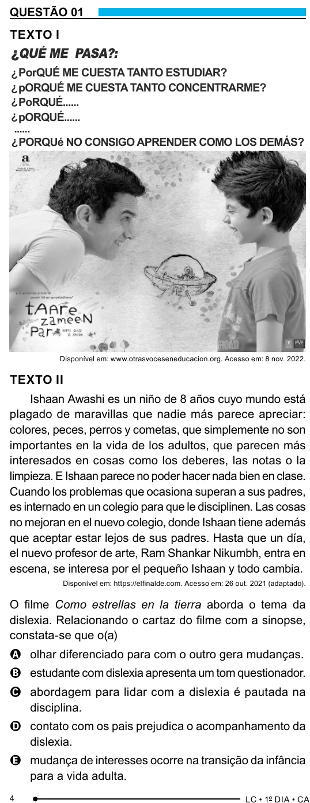

Texto extraído (pode conter ruído)

QUESTÃO 01  
TEXTO I  
?  
QUÉ ME PASA?:  
?  
PorQUÉ ME CUESTA TANTO ESTUDIAR?  
?  
pORQUÉ ME CUESTA TANTO CONCENTRARME?  
?  
PoRQUÉ......  
?  
pORQUÉ......  
......  
?  
PORQUé NO CONSIGO APRENDER COMO LOS DEMÁS?  
Disponível em: www.otrasvoceseneducacion.org. Acesso em: 8 nov. 2022.  
TEXTO II  
Ishaan Awashi es un niño de 8 años cuyo mundo está  
plagado de maravillas que nadie más parece apreciar:  
colores, peces, perros y cometas, que simplemente no son  
importantes en la vida de los adultos, que parecen más  
interesados en cosas como los deberes, las notas o la  
limpieza. E Ishaan parece no poder hacer nada bien en clase.  
Cuando los problemas que ocasiona superan a sus padres,  
es internado en un colegio para que le disciplinen. Las cosas  
no mejoran en el nuevo colegio, donde Ishaan tiene además  
que aceptar estar lejos de sus padres. Hasta que un día,  
el nuevo profesor de arte, Ram Shankar Nikumbh, entra en  
escena, se interesa por el pequeño Ishaan y todo cambia.  
Disponível em: https://elfinalde.com. Acesso em: 26 out. 2021 (adaptado).  
O filme Como estrellas en la tierra aborda o tema da  
dislexia. Relacionando o cartaz do filme com a sinopse,  
constata-se que o(a)  
A olhar diferenciado para com o outro gera mudanças.  
B estudante com dislexia apresenta um tom questionador.  
C abordagem para lidar com a dislexia é pautada na  
disciplina.  
D contato com os pais prejudica o acompanhamento da  
dislexia.  
E mudança de interesses ocorre na transição da infância  
para a vida adulta.  
4

