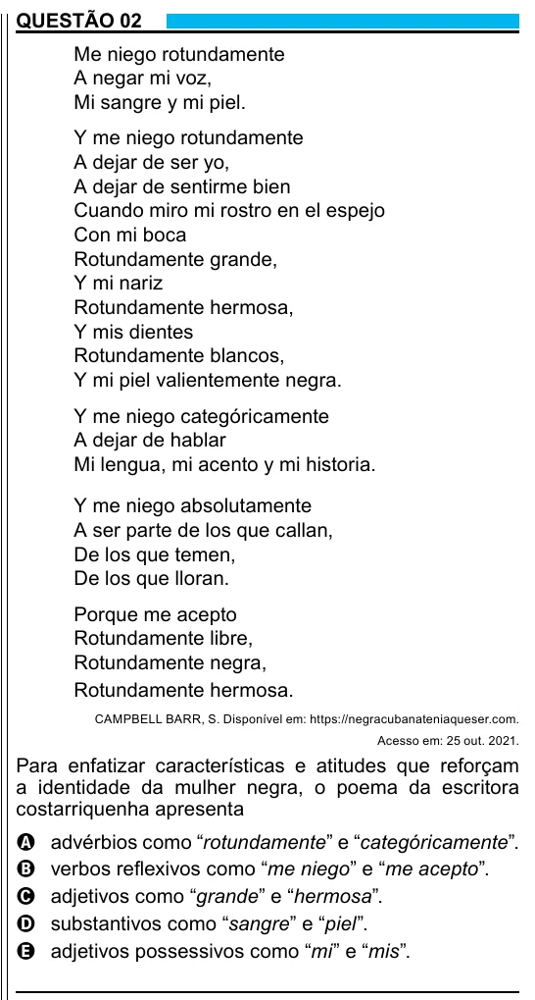

Texto extraído (pode conter ruído)

QUESTÃO 02  
Me niego rotundamente  
A negar mi voz,  
Mi sangre y mi piel.  
Y me niego rotundamente  
A dejar de ser yo,  
A dejar de sentirme bien  
Cuando miro mi rostro en el espejo  
Con mi boca  
Rotundamente grande,  
Y mi nariz  
Rotundamente hermosa,  
Y mis dientes  
Rotundamente blancos,  
Y mi piel valientemente negra.  
Y me niego categóricamente  
A dejar de hablar  
Mi lengua, mi acento y mi historia.  
Y me niego absolutamente  
A ser parte de los que callan,  
De los que temen,  
De los que lloran.  
Porque me acepto  
Rotundamente libre,  
Rotundamente negra,  
Rotundamente hermosa.  
CAMPBELL BARR, S. Disponível em: https://negracubanateniaqueser.com.  
Acesso em: 25 out. 2021.  
Para enfatizar características e atitudes que reforçam  
a identidade da mulher negra, o poema da escritora  
costarriquenha apresenta  
A  
advérbios como “rotundamente” e “categóricamente”.  
verbos reflexivos como “me niego” e “me acepto”.  
B  
adjetivos como “grande” e “hermosa”.  
C  
substantivos como “sangre” e “piel”.  
D  
adjetivos possessivos como “mi” e “mis”.  
E

