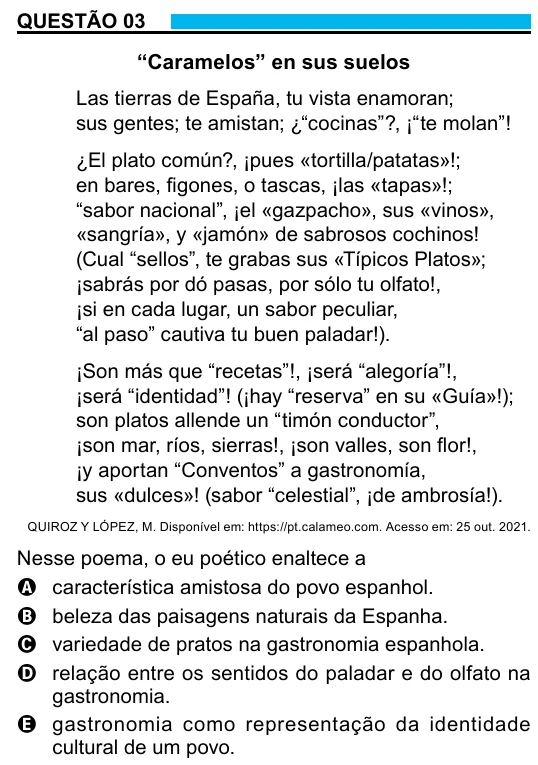

Texto extraído (pode conter ruído)

QUESTÃO 03  
“Caramelos” en sus suelos  
Las tierras de España, tu vista enamoran;  
sus gentes; te amistan; ¿“cocinas”?, ¡“te molan”!  
¿El plato común?, ¡pues «tortilla/patatas»!;  
en bares, figones, o tascas, ¡las «tapas»!;  
“sabor nacional”, ¡el «gazpacho», sus «vinos»,  
«sangría», y «jamón» de sabrosos cochinos!  
(Cual “sellos”, te grabas sus «Típicos Platos»;  
¡sabrás por dó pasas, por sólo tu olfato!,  
¡si en cada lugar, un sabor peculiar,  
“al paso” cautiva tu buen paladar!).  
¡Son más que “recetas”!, ¡será “alegoría”!,  
¡será “identidad”! (¡hay “reserva” en su «Guía»!);  
son platos allende un “timón conductor”,  
¡son mar, ríos, sierras!, ¡son valles, son flor!,  
¡y aportan “Conventos” a gastronomía,  
sus «dulces»! (sabor “celestial”, ¡de ambrosía!).  
QUIROZ Y LÓPEZ, M. Disponível em: https://pt.calameo.com. Acesso em: 25 out. 2021.  
Nesse poema, o eu poético enaltece a  
A característica amistosa do povo espanhol.  
B beleza das paisagens naturais da Espanha.  
C variedade de pratos na gastronomia espanhola.  
D relação entre os sentidos do paladar e do olfato na  
gastronomia.  
E gastronomia como representação da identidade  
cultural de um povo.

