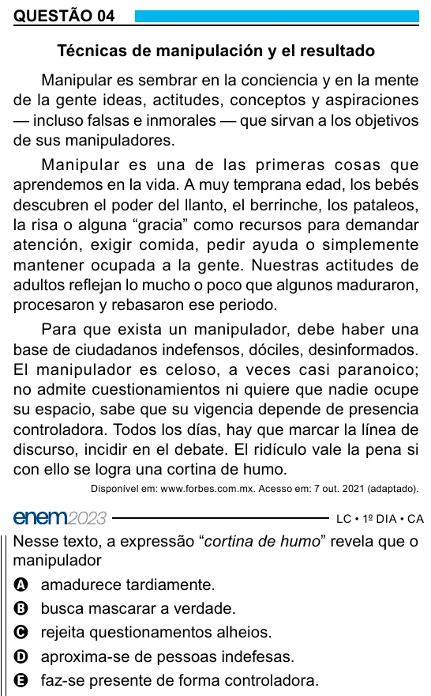

Texto extraído (pode conter ruído)

QUESTÃO 04  
Técnicas de manipulación y el resultado  
Manipular es sembrar en la conciencia y en la mente  
de la gente ideas, actitudes, conceptos y aspiraciones  
— incluso falsas e inmorales — que sirvan a los objetivos  
de sus manipuladores.  
Manipular es una de las primeras cosas que  
aprendemos en la vida. A muy temprana edad, los bebés  
descubren el poder del llanto, el berrinche, los pataleos,  
la risa o alguna “gracia” como recursos para demandar  
atención, exigir comida, pedir ayuda o simplemente  
mantener ocupada a la gente. Nuestras actitudes de  
adultos reflejan lo mucho o poco que algunos maduraron,  
procesaron y rebasaron ese periodo.  
Para que exista un manipulador, debe haber una  
base de ciudadanos indefensos, dóciles, desinformados.  
El manipulador es celoso, a veces casi paranoico;  
no admite cuestionamientos ni quiere que nadie ocupe  
su espacio, sabe que su vigencia depende de presencia  
controladora. Todos los días, hay que marcar la línea de  
discurso, incidir en el debate. El ridículo vale la pena si  
con ello se logra una cortina de humo.  
Disponível em: www.forbes.com.mx. Acesso em: 7 out. 2021 (adaptado).  
Nesse texto, a expressão “cortina de humo” revela que o  
manipulador  
A amadurece tardiamente.  
B busca mascarar a verdade.  
C rejeita questionamentos alheios.  
D aproxima-se de pessoas indefesas.  
E faz-se presente de forma controladora.

