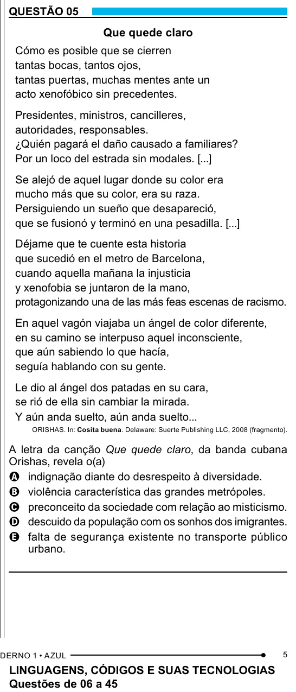

Texto extraído (pode conter ruído)

QUESTÃO 05  
Que quede claro  
Cómo es posible que se cierren  
tantas bocas, tantos ojos,  
tantas puertas, muchas mentes ante un  
acto xenofóbico sin precedentes.  
Presidentes, ministros, cancilleres,  
autoridades, responsables.  
¿Quién pagará el daño causado a familiares?  
Por un loco del estrada sin modales. [...]  
Se alejó de aquel lugar donde su color era  
mucho más que su color, era su raza.  
Persiguiendo un sueño que desapareció,  
que se fusionó y terminó en una pesadilla. [...]  
Déjame que te cuente esta historia  
que sucedió en el metro de Barcelona,  
cuando aquella mañana la injusticia  
y xenofobia se juntaron de la mano,  
protagonizando una de las más feas escenas de racismo.  
En aquel vagón viajaba un ángel de color diferente,  
en su camino se interpuso aquel inconsciente,  
que aún sabiendo lo que hacía,  
seguía hablando con su gente.  
Le dio al ángel dos patadas en su cara,  
se rió de ella sin cambiar la mirada.  
Y aún anda suelto, aún anda suelto...  
ORISHAS. In: Cosita buena. Delaware: Suerte Publishing LLC, 2008 (fragmento).  
A letra da canção Que quede claro, da banda cubana  
Orishas, revela o(a)  
A indignação diante do desrespeito à diversidade.  
B violência característica das grandes metrópoles.  
C preconceito da sociedade com relação ao misticismo.  
D descuido da população com os sonhos dos imigrantes.  
E falta de segurança existente no transporte público  
urbano.  
5  
LINGUAGENS, CÓDIGOS E SUAS TECNOLOGIAS  
Questões de 06 a 45

