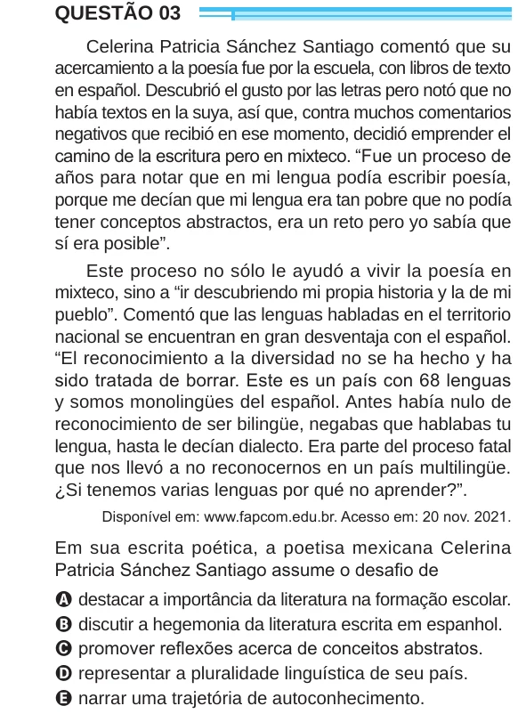

Texto extraído (pode conter ruído)

QUESTÃO 03  
Celerina Patricia Sánchez Santiago comentó que su  
acercamiento a la poesía fue por la escuela, con libros de texto  
en español. Descubrió el gusto por las letras pero notó que no  
había textos en la suya, así que, contra muchos comentarios  
negativos que recibió en ese momento, decidió emprender el  
camino de la escritura pero en mixteco. “Fue un proceso de  
años para notar que en mi lengua podía escribir poesía,  
porque me decían que mi lengua era tan pobre que no podía  
tener conceptos abstractos, era un reto pero yo sabía que  
sí era posible”.  
Este proceso no sólo le ayudó a vivir la poesía en  
mixteco, sino a “ir descubriendo mi propia historia y la de mi  
pueblo”. Comentó que las lenguas habladas en el territorio  
nacional se encuentran en gran desventaja con el español.  
“El reconocimiento a la diversidad no se ha hecho y ha  
sido tratada de borrar. Este es un país con 68 lenguas  
y somos monolingües del español. Antes había nulo de  
reconocimiento de ser bilingüe, negabas que hablabas tu  
lengua, hasta le decían dialecto. Era parte del proceso fatal  
que nos llevó a no reconocernos en un país multilingüe.  
¿Si tenemos varias lenguas por qué no aprender?”.  
Disponível em: www.fapcom.edu.br. Acesso em: 20 nov. 2021.  
Em sua escrita poética, a poetisa mexicana Celerina  
Patricia Sánchez Santiago assume o desafio de  
A destacar a importância da literatura na formação escolar.  
B discutir a hegemonia da literatura escrita em espanhol.  
C promover reflexões acerca de conceitos abstratos.  
D representar a pluralidade linguística de seu país.  
E narrar uma trajetória de autoconhecimento.

