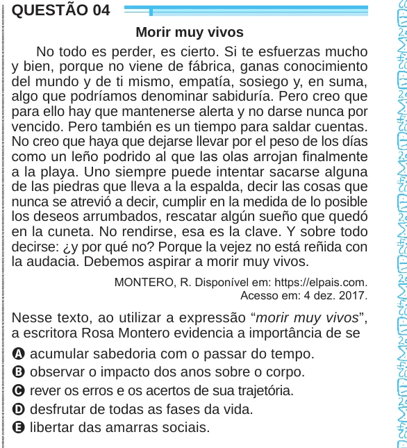

Texto extraído (pode conter ruído)

QUESTÃO 04  
Morir muy vivos  
No todo es perder, es cierto. Si te esfuerzas mucho  
y bien, porque no viene de fábrica, ganas conocimiento  
del mundo y de ti mismo, empatía, sosiego y, en suma,  
algo que podríamos denominar sabiduría. Pero creo que  
para ello hay que mantenerse alerta y no darse nunca por  
vencido. Pero también es un tiempo para saldar cuentas.  
No creo que haya que dejarse llevar por el peso de los días  
como un leño podrido al que las olas arrojan finalmente  
a la playa. Uno siempre puede intentar sacarse alguna  
de las piedras que lleva a la espalda, decir las cosas que  
nunca se atrevió a decir, cumplir en la medida de lo posible  
los deseos arrumbados, rescatar algún sueño que quedó  
en la cuneta. No rendirse, esa es la clave. Y sobre todo  
decirse: ¿y por qué no? Porque la vejez no está reñida con  
la audacia. Debemos aspirar a morir muy vivos.  
MONTERO, R. Disponível em: https://elpais.com.  
Acesso em: 4 dez. 2017.  
Nesse texto, ao utilizar a expressão “morir muy vivos”,  
a escritora Rosa Montero evidencia a importância de se  
A acumular sabedoria com o passar do tempo.  
B observar o impacto dos anos sobre o corpo.  
C rever os erros e os acertos de sua trajetória.  
D desfrutar de todas as fases da vida.  
E libertar das amarras sociais.

