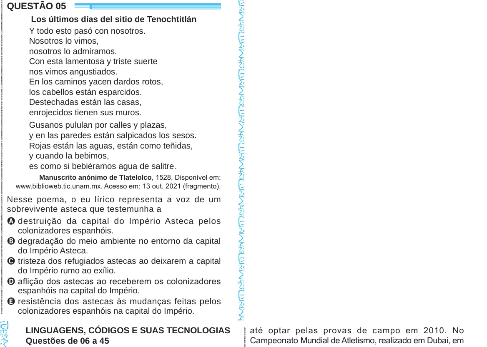

Texto extraído (pode conter ruído)

QUESTÃO 05  
Los últimos días del sitio de Tenochtitlán  
Y todo esto pasó con nosotros.  
Nosotros lo vimos,  
nosotros lo admiramos.  
Con esta lamentosa y triste suerte  
nos vimos angustiados.  
En los caminos yacen dardos rotos,  
los cabellos están esparcidos.  
Destechadas están las casas,  
enrojecidos tienen sus muros.  
Gusanos pululan por calles y plazas,  
y en las paredes están salpicados los sesos.  
Rojas están las aguas, están como teñidas,  
y cuando la bebimos,  
es como si bebiéramos agua de salitre.  
Manuscrito anónimo de Tlatelolco, 1528. Disponível em:  
www.biblioweb.tic.unam.mx. Acesso em: 13 out. 2021 (fragmento).  
Nesse poema, o eu lírico representa a voz de um  
sobrevivente asteca que testemunha a  
A destruição da capital do Império Asteca pelos  
colonizadores espanhóis.  
B degradação do meio ambiente no entorno da capital  
do Império Asteca.  
C tristeza dos refugiados astecas ao deixarem a capital  
do Império rumo ao exílio.  
D aflição dos astecas ao receberem os colonizadores  
espanhóis na capital do Império.  
E resistência dos astecas às mudanças feitas pelos  
colonizadores espanhóis na capital do Império.  
até optar pelas provas de campo em 2010. No  
LINGUAGENS, CÓDIGOS E SUAS TECNOLOGIAS  
Campeonato Mundial de Atletismo, realizado em Dubai, em  
Questões de 06 a 45

