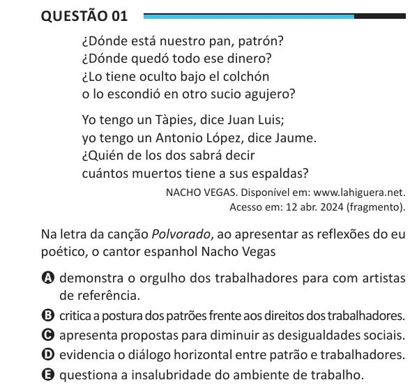

Texto extraído (pode conter ruído)

Questão 01  
¿Dónde está nuestro pan, patrón?  
¿Dónde quedó todo ese dinero?  
¿Lo tiene oculto bajo el colchón  
o lo escondió en otro sucio agujero?  
Yo tengo un Tàpies, dice Juan Luis;  
yo tengo un Antonio López, dice Jaume.  
¿Quién de los dos sabrá decir  
cuántos muertos tiene a sus espaldas?  
NACHO VEGAS. Disponível em: www.lahiguera.net.  
Acesso em: 12 abr. 2024 (fragmento).  
Na letra da canção Polvorado, ao apresentar as reflexões do eu  
poético, o cantor espanhol Nacho Vegas  
A demonstra o orgulho dos trabalhadores para com artistas  
de referência.  
B critica a postura dos patrões frente aos direitos dos trabalhadores.  
C apresenta propostas para diminuir as desigualdades sociais.  
D evidencia o diálogo horizontal entre patrão e trabalhadores.  
E questiona a insalubridade do ambiente de trabalho.

