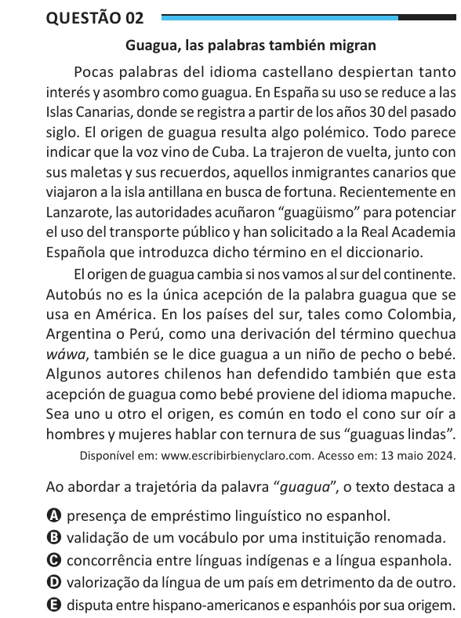

Texto extraído (pode conter ruído)

Questão 02  
Guagua, las palabras también migran  
Pocas palabras del idioma castellano despiertan tanto  
interés y asombro como guagua. En España su uso se reduce a las  
Islas Canarias, donde se registra a partir de los años 30 del pasado  
siglo. El origen de guagua resulta algo polémico. Todo parece  
indicar que la voz vino de Cuba. La trajeron de vuelta, junto con  
sus maletas y sus recuerdos, aquellos inmigrantes canarios que  
viajaron a la isla antillana en busca de fortuna. Recientemente en  
Lanzarote, las autoridades acuñaron “guagüismo” para potenciar  
el uso del transporte público y han solicitado a la Real Academia  
Española que introduzca dicho término en el diccionario.  
El origen de guagua cambia si nos vamos al sur del continente.  
Autobús no es la única acepción de la palabra guagua que se  
usa en América. En los países del sur, tales como Colombia,  
Argentina o Perú, como una derivación del término quechua  
wáwa, también se le dice guagua a un niño de pecho o bebé.  
Algunos autores chilenos han defendido también que esta  
acepción de guagua como bebé proviene del idioma mapuche.  
Sea uno u otro el origen, es común en todo el cono sur oír a  
hombres y mujeres hablar con ternura de sus “guaguas lindas”.  
Disponível em: www.escribirbienyclaro.com. Acesso em: 13 maio 2024.  
Ao abordar a trajetória da palavra “guagua”, o texto destaca a  
A presença de empréstimo linguístico no espanhol.  
B validação de um vocábulo por uma instituição renomada.  
C concorrência entre línguas indígenas e a língua espanhola.  
D valorização da língua de um país em detrimento da de outro.  
E disputa entre hispano-americanos e espanhóis por sua origem.

