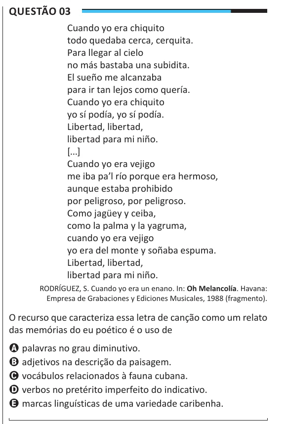

Texto extraído (pode conter ruído)

Questão 03  
Cuando yo era chiquito  
todo quedaba cerca, cerquita.  
Para llegar al cielo  
no más bastaba una subidita.  
El sueño me alcanzaba  
para ir tan lejos como quería.  
Cuando yo era chiquito  
yo sí podía, yo sí podía.  
Libertad, libertad,  
libertad para mi niño.  
[...]  
Cuando yo era vejigo  
me iba pa’l río porque era hermoso,  
aunque estaba prohibido  
por peligroso, por peligroso.  
Como jagüey y ceiba,  
como la palma y la yagruma,  
cuando yo era vejigo  
yo era del monte y soñaba espuma.  
Libertad, libertad,  
libertad para mi niño.  
RODRÍGUEZ, S. Cuando yo era un enano. In: Oh Melancolía. Havana:  
Empresa de Grabaciones y Ediciones Musicales, 1988 (fragmento).  
O recurso que caracteriza essa letra de canção como um relato  
das memórias do eu poético é o uso de  
A palavras no grau diminutivo.  
B adjetivos na descrição da paisagem.  
C vocábulos relacionados à fauna cubana.  
D verbos no pretérito imperfeito do indicativo.  
E marcas linguísticas de uma variedade caribenha.

