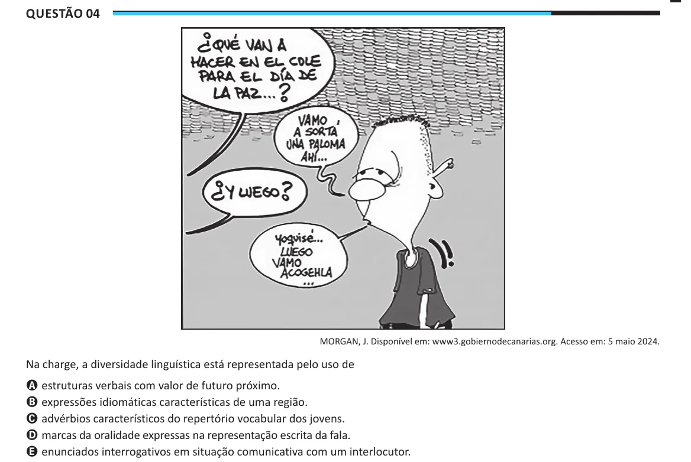

Texto extraído (pode conter ruído)

Questão 04  
MORGAN, J. Disponível em: www3.gobiernodecanarias.org. Acesso em: 5 maio 2024.  
Na charge, a diversidade linguística está representada pelo uso de  
A estruturas verbais com valor de futuro próximo.  
B expressões idiomáticas características de uma região.  
C advérbios característicos do repertório vocabular dos jovens.  
D marcas da oralidade expressas na representação escrita da fala.  
E enunciados interrogativos em situação comunicativa com um interlocutor.

