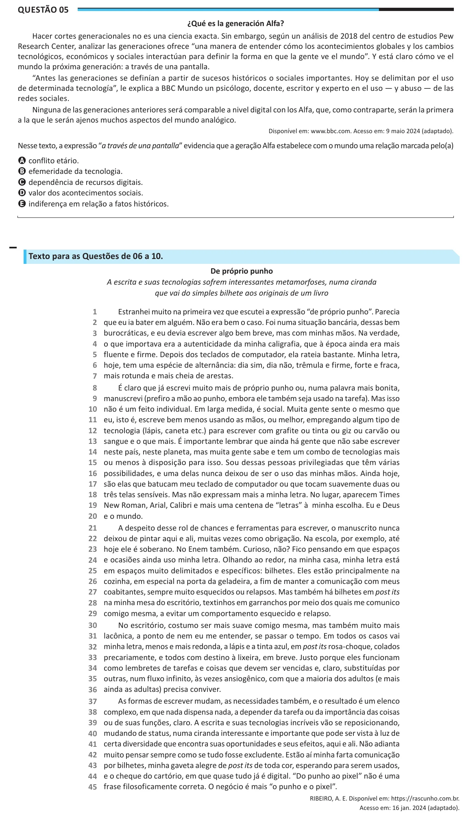

Texto extraído (pode conter ruído)

Questão 05  
¿Qué es la generación Alfa?  
Hacer cortes generacionales no es una ciencia exacta. Sin embargo, según un análisis de 2018 del centro de estudios Pew  
Research Center, analizar las generaciones ofrece “una manera de entender cómo los acontecimientos globales y los cambios  
tecnológicos, económicos y sociales interactúan para definir la forma en que la gente ve el mundo”. Y está claro cómo ve el  
mundo la próxima generación: a través de una pantalla.  
“Antes las generaciones se definían a partir de sucesos históricos o sociales importantes. Hoy se delimitan por el uso  
de determinada tecnología”, le explica a BBC Mundo un psicólogo, docente, escritor y experto en el uso — y abuso — de las  
redes sociales.  
Ninguna de las generaciones anteriores será comparable a nivel digital con los Alfa, que, como contraparte, serán la primera  
a la que le serán ajenos muchos aspectos del mundo analógico.  
Disponível em: www.bbc.com. Acesso em: 9 maio 2024 (adaptado).  
Nesse texto, a expressão “a través de una pantalla” evidencia que a geração Alfa estabelece com o mundo uma relação marcada pelo(a)  
A conflito etário.  
B efemeridade da tecnologia.  
C dependência de recursos digitais.  
D valor dos acontecimentos sociais.  
E indiferença em relação a fatos históricos.  
Texto para as Questões de 06 a 10.  
De próprio punho  
A escrita e suas tecnologias sofrem interessantes metamorfoses, numa ciranda  
que vai do simples bilhete aos originais de um livro  
1  
Estranhei muito na primeira vez que escutei a expressão “de próprio punho”. Parecia  
2  
que eu ia bater em alguém. Não era bem o caso. Foi numa situação bancária, dessas bem  
3  
burocráticas, e eu devia escrever algo bem breve, mas com minhas mãos. Na verdade,  
4  
o que importava era a autenticidade da minha caligrafia, que à época ainda era mais  
5  
fluente e firme. Depois dos teclados de computador, ela rateia bastante. Minha letra,  
6  
hoje, tem uma espécie de alternância: dia sim, dia não, trêmula e firme, forte e fraca,  
7  
mais rotunda e mais cheia de arestas.  
8  
É claro que já escrevi muito mais de próprio punho ou, numa palavra mais bonita,  
9  
manuscrevi (prefiro a mão ao punho, embora ele também seja usado na tarefa). Mas isso  
10  
não é um feito individual. Em larga medida, é social. Muita gente sente o mesmo que  
11  
eu, isto é, escreve bem menos usando as mãos, ou melhor, empregando algum tipo de  
12  
tecnologia (lápis, caneta etc.) para escrever com grafite ou tinta ou giz ou carvão ou  
13  
sangue e o que mais. É importante lembrar que ainda há gente que não sabe escrever  
14  
neste país, neste planeta, mas muita gente sabe e tem um combo de tecnologias mais  
15  
ou menos à disposição para isso. Sou dessas pessoas privilegiadas que têm várias  
16  
possibilidades, e uma delas nunca deixou de ser o uso das minhas mãos. Ainda hoje,  
17  
são elas que batucam meu teclado de computador ou que tocam suavemente duas ou  
18  
três telas sensíveis. Mas não expressam mais a minha letra. No lugar, aparecem Times  
19  
New Roman, Arial, Calibri e mais uma centena de “letras” à minha escolha. Eu e Deus  
20  
e o mundo.  
21  
A despeito desse rol de chances e ferramentas para escrever, o manuscrito nunca  
22  
deixou de pintar aqui e ali, muitas vezes como obrigação. Na escola, por exemplo, até  
23  
hoje ele é soberano. No Enem também. Curioso, não? Fico pensando em que espaços  
24  
e ocasiões ainda uso minha letra. Olhando ao redor, na minha casa, minha letra está  
25  
em espaços muito delimitados e específicos: bilhetes. Eles estão principalmente na  
26  
cozinha, em especial na porta da geladeira, a fim de manter a comunicação com meus  
27  
coabitantes, sempre muito esquecidos ou relapsos. Mas também há bilhetes em post its  
28  
na minha mesa do escritório, textinhos em garranchos por meio dos quais me comunico  
29  
comigo mesma, a evitar um comportamento esquecido e relapso.  
30  
No escritório, costumo ser mais suave comigo mesma, mas também muito mais  
31  
lacônica, a ponto de nem eu me entender, se passar o tempo. Em todos os casos vai  
32  
minha letra, menos e mais redonda, a lápis e a tinta azul, em post its rosa-choque, colados  
33  
precariamente, e todos com destino à lixeira, em breve. Justo porque eles funcionam  
34  
como lembretes de tarefas e coisas que devem ser vencidas e, claro, substituídas por  
35  
outras, num fluxo infinito, às vezes ansiogênico, com que a maioria dos adultos (e mais  
36  
ainda as adultas) precisa conviver.  
37  
As formas de escrever mudam, as necessidades também, e o resultado é um elenco  
38  
complexo, em que nada dispensa nada, a depender da tarefa ou da importância das coisas  
39  
ou de suas funções, claro. A escrita e suas tecnologias incríveis vão se reposicionando,  
40  
mudando de status, numa ciranda interessante e importante que pode ser vista à luz de  
41  
certa diversidade que encontra suas oportunidades e seus efeitos, aqui e ali. Não adianta  
42  
muito pensar sempre como se tudo fosse excludente. Estão aí minha farta comunicação  
43  
por bilhetes, minha gaveta alegre de post its de toda cor, esperando para serem usados,  
44  
e o cheque do cartório, em que quase tudo já é digital. “Do punho ao pixel” não é uma  
45  
frase filosoficamente correta. O negócio é mais “o punho e o pixel”.  
RIBEIRO, A. E. Disponível em: https://rascunho.com.br.  
Acesso em: 16 jan. 2024 (adaptado).

