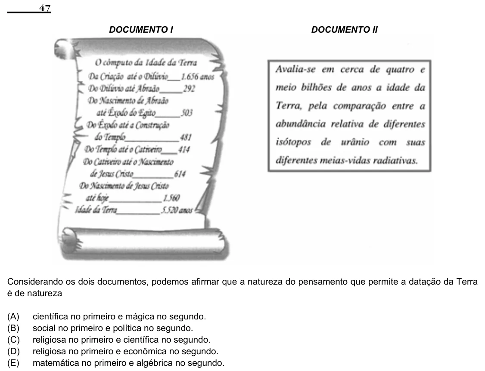

Texto extraído (pode conter ruído)

47  
DOCUMENTO I  
DOCUMENTO II  
Considerando os dois documentos, podemos afirmar que a natureza do pensamento que permite a datação da Terra  
é de natureza  
(A)  
científica no primeiro e mágica no segundo.  
(B)  
social no primeiro e política no segundo.  
(C)  
religiosa no primeiro e científica no segundo.  
(D)  
religiosa no primeiro e econômica no segundo.  
(E)  
matemática no primeiro e algébrica no segundo.

