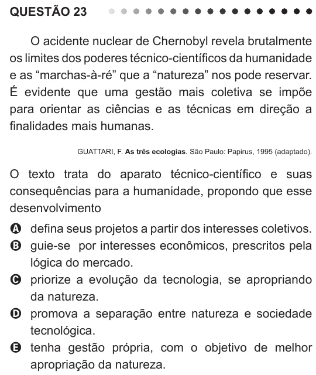

Texto extraído (pode conter ruído)

QUESTÃO 23  
O acidente nuclear de Chernobyl revela brutalmente  
os limites dos poderes técnico-científicos da humanidade  
e as “marchas-à-ré” que a “natureza” nos pode reservar.  
É evidente que uma gestão mais coletiva se impõe  
para orientar as ciências e as técnicas em direção a  
finalidades mais humanas.  
GUATTARI, F. As três ecologias. São Paulo: Papirus, 1995 (adaptado).  
O texto trata do aparato técnico-científico e suas  
consequências para a humanidade, propondo que esse  
desenvolvimento  
A defina seus projetos a partir dos interesses coletivos.  
B guie-se por interesses econômicos, prescritos pela  
lógica do mercado.  
C priorize a evolução da tecnologia, se apropriando  
da natureza.  
D promova a separação entre natureza e sociedade  
tecnológica.  
E tenha gestão própria, com o objetivo de melhor  
apropriação da natureza.

