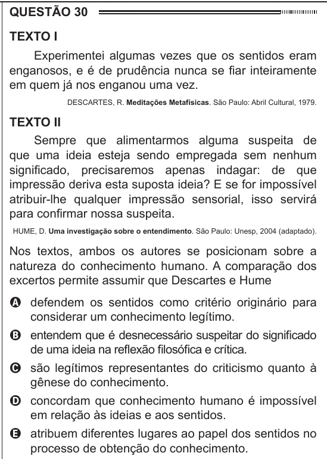

Texto extraído (pode conter ruído)

QUESTÃO 30  
Texto I  
Experimentei algumas vezes que os sentidos eram  
enganosos, e é de prudência nunca se fiar inteiramente  
em quem já nos enganou uma vez.  
DESCARTES, R. Meditações Metafísicas. São Paulo: Abril Cultural, 1979.  
Texto II  
Sempre que alimentarmos alguma suspeita de  
que uma ideia esteja sendo empregada sem nenhum  
significado, precisaremos apenas indagar: de que  
impressão deriva esta suposta ideia? E se for impossível  
atribuir-lhe qualquer impressão sensorial, isso servirá  
para confirmar nossa suspeita.  
HUME, D. Uma investigação sobre o entendimento. São Paulo: Unesp, 2004 (adaptado).  
Nos textos, ambos os autores se posicionam sobre a  
natureza do conhecimento humano. A comparação dos  
excertos permite assumir que Descartes e Hume  
A defendem os sentidos como critério originário para  
considerar um conhecimento legítimo.  
B entendem que é desnecessário suspeitar do significado  
de uma ideia na reflexão filosófica e crítica.  
C são legítimos representantes do criticismo quanto à  
gênese do conhecimento.  
D concordam que conhecimento humano é impossível  
em relação às ideias e aos sentidos.  
E atribuem diferentes lugares ao papel dos sentidos no  
processo de obtenção do conhecimento.

