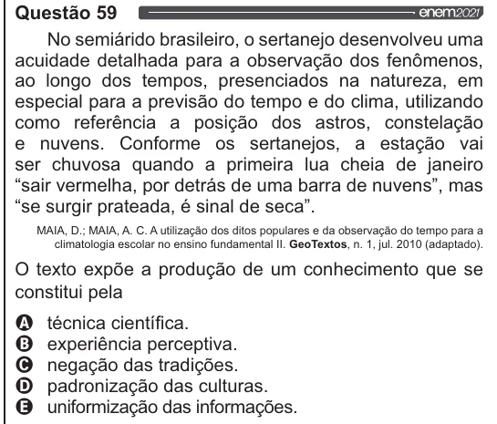

Texto extraído (pode conter ruído)

Questão 59  
No semiárido brasileiro, o sertanejo desenvolveu uma  
acuidade detalhada para a observação dos fenômenos,  
ao longo dos tempos, presenciados na natureza, em  
especial para a previsão do tempo e do clima, utilizando  
como referência a posição dos astros, constelação  
e nuvens. Conforme os sertanejos, a estação vai  
ser chuvosa quando a primeira lua cheia de janeiro  
“sair vermelha, por detrás de uma barra de nuvens”, mas  
“se surgir prateada, é sinal de seca”.  
MAIA, D.; MAIA, A. C. A utilização dos ditos populares e da observação do tempo para a  
climatologia escolar no ensino fundamental Il. GeoTextos, n. 1, jul. 2010 (adaptado).  
O texto expõe a produção de um conhecimento que se  
constitui pela  
VOGOS  
técnica científica.  
experiência perceptiva.  
negação das tradições.  
padronização das culturas.  
uniformização das informações.

