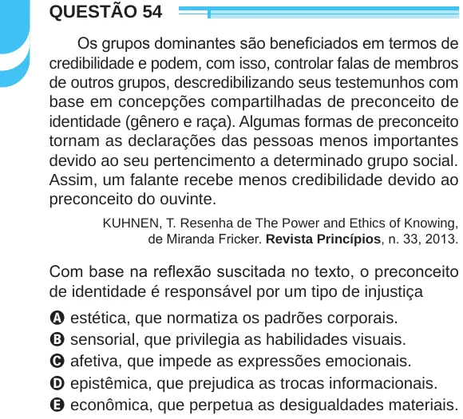

Texto extraído (pode conter ruído)

QUESTÃO 54  
Os grupos dominantes são beneficiados em termos de  
credibilidade e podem, com isso, controlar falas de membros  
de outros grupos, descredibilizando seus testemunhos com  
base em concepções compartilhadas de preconceito de  
identidade (gênero e raça). Algumas formas de preconceito  
tornam as declarações das pessoas menos importantes  
devido ao seu pertencimento a determinado grupo social.  
Assim, um falante recebe menos credibilidade devido ao  
preconceito do ouvinte.  
KUHNEN, T. Resenha de The Power and Ethics of Knowing,  
de Miranda Fricker. Revista Princípios, n. 33, 2013.  
Com base na reflexão suscitada no texto, o preconceito  
de identidade é responsável por um tipo de injustiça  
A estética, que normatiza os padrões corporais.  
B sensorial, que privilegia as habilidades visuais.  
C afetiva, que impede as expressões emocionais.  
D epistêmica, que prejudica as trocas informacionais.  
E econômica, que perpetua as desigualdades materiais.

