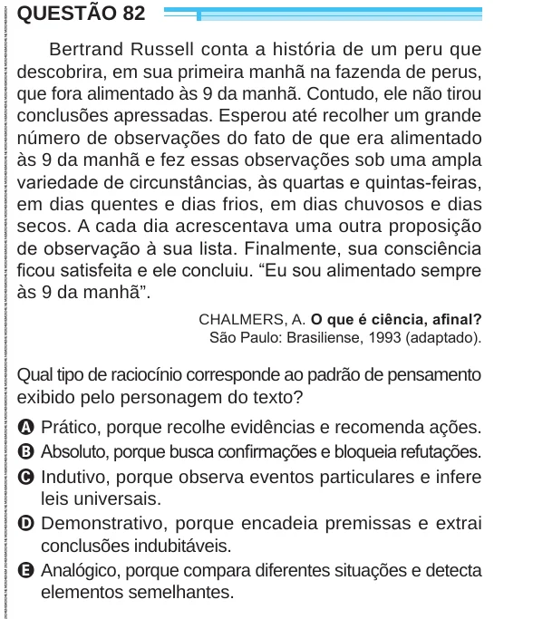

Texto extraído (pode conter ruído)

QUESTÃO 82  
Bertrand Russell conta a história de um peru que  
descobrira, em sua primeira manhã na fazenda de perus,  
que fora alimentado às 9 da manhã. Contudo, ele não tirou  
conclusões apressadas. Esperou até recolher um grande  
número de observações do fato de que era alimentado  
às 9 da manhã e fez essas observações sob uma ampla  
variedade de circunstâncias, às quartas e quintas-feiras,  
em dias quentes e dias frios, em dias chuvosos e dias  
secos. A cada dia acrescentava uma outra proposição  
de observação à sua lista. Finalmente, sua consciência  
ficou satisfeita e ele concluiu. “Eu sou alimentado sempre  
às 9 da manhã”.  
CHALMERS, A. O que é ciência, afinal?  
São Paulo: Brasiliense, 1993 (adaptado).  
Qual tipo de raciocínio corresponde ao padrão de pensamento  
exibido pelo personagem do texto?  
A Prático, porque recolhe evidências e recomenda ações.  
B Absoluto, porque busca confirmações e bloqueia refutações.  
C Indutivo, porque observa eventos particulares e infere  
leis universais.  
D Demonstrativo, porque encadeia premissas e extrai  
conclusões indubitáveis.  
E Analógico, porque compara diferentes situações e detecta  
elementos semelhantes.

