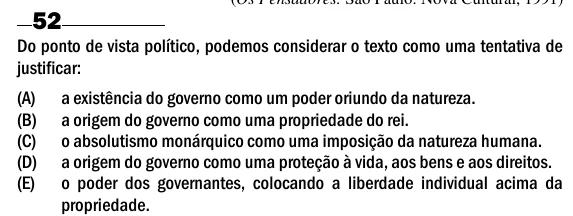

Texto extraído (pode conter ruído)

52  
Do ponto de vista político, podemos considerar o texto como uma tentativa de  
justificar:  
(A)  
a existência do governo como um poder oriundo da natureza.  
(B)  
a origem do governo como uma propriedade do rei.  
(C)  
o absolutismo monárquico como uma imposição da natureza humana.  
(D)  
a origem do governo como uma proteção à vida, aos bens e aos direitos.  
(E)  
o poder dos governantes, colocando a liberdade individual acima da  
propriedade.

