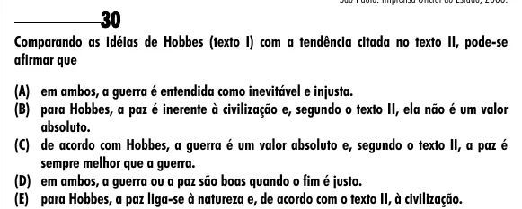

Texto extraído (pode conter ruído)

30  
Comparando as idéias de Hobbes (texto I) com a tendência citada no texto II, pode-se  
afirmar que  
(A) em ambos, a guerra é entendida como inevitável e injusta.  
(B) para Hobbes, a paz é inerente à civilização e, segundo o texto II, ela não é um valor  
absoluto.  
(C) de acordo com Hobbes, a guerra é um valor absoluto e, segundo o texto II, a paz é  
sempre melhor que a guerra.  
(D) em ambos, a guerra ou a paz são boas quando o fim é justo.  
(E) para Hobbes, a paz liga-se à natureza e, de acordo com o texto II, à civilização.

