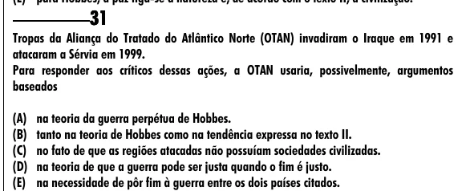

Texto extraído (pode conter ruído)

31  
Tropas da Aliança do Tratado do Atlântico Norte (OTAN) invadiram o Iraque em 1991 e  
atacaram a Sérvia em 1999.  
Para responder aos críticos dessas ações, a OTAN usaria, possivelmente, argumentos  
baseados  
(A) na teoria da guerra perpétua de Hobbes.  
(B) tanto na teoria de Hobbes como na tendência expressa no texto II.  
(C) no fato de que as regiões atacadas não possuíam sociedades civilizadas.  
(D) na teoria de que a guerra pode ser justa quando o fim é justo.  
(E) na necessidade de pôr fim à guerra entre os dois países citados.

