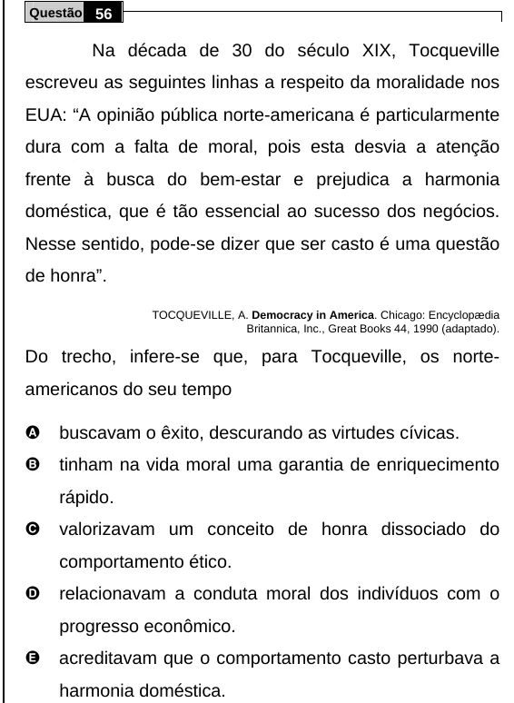

Texto extraído (pode conter ruído)

Questão 56  
Na década de 30 do século XIX, Tocqueville  
escreveu as seguintes linhas a respeito da moralidade nos  
EUA: “A opinião pública norte-americana é particularmente  
dura com a falta de moral, pois esta desvia a atenção  
frente à busca do bem-estar e prejudica a harmonia  
doméstica, que é tão essencial ao sucesso dos negócios.  
Nesse sentido, pode-se dizer que ser casto é uma questão  
de honra”.  
TOCQUEVILLE, A. Democracy in America. Chicago: Encyclopædia  
Britannica, Inc., Great Books 44, 1990 (adaptado).  
Do trecho, infere-se que, para Tocqueville, os norte-  
americanos do seu tempo  
A  
buscavam o êxito, descurando as virtudes cívicas.  
B  
tinham na vida moral uma garantia de enriquecimento  
rápido.  
C  
valorizavam um conceito de honra dissociado do  
comportamento ético.  
D  
relacionavam a conduta moral dos indivíduos com o  
progresso econômico.  
E  
acreditavam que o comportamento casto perturbava a  
harmonia doméstica.

