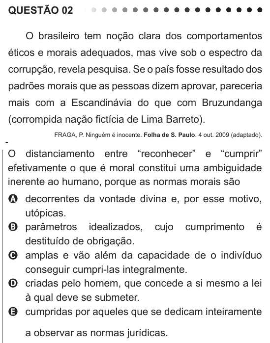

Texto extraído (pode conter ruído)

QUESTÃO 02  
O brasileiro tem noção clara dos comportamentos  
éticos e morais adequados, mas vive sob o espectro da  
corrupção, revela pesquisa. Se o país fosse resultado dos  
padrões morais que as pessoas dizem aprovar, pareceria  
mais com a Escandinávia do que com Bruzundanga  
(corrompida nação fictícia de Lima Barreto).  
FRAGA, P. Ninguém é inocente. Folha de S. Paulo. 4 out. 2009 (adaptado).  
O distanciamento entre “reconhecer” e “cumprir”  
efetivamente o que é moral constitui uma ambiguidade  
inerente ao humano, porque as normas morais são  
A decorrentes da vontade divina e, por esse motivo,  
utópicas.  
B parâmetros idealizados, cujo cumprimento é  
destituído de obrigação.  
C amplas e vão além da capacidade de o indivíduo  
conseguir cumpri-las integralmente.  
D criadas pelo homem, que concede a si mesmo a lei  
à qual deve se submeter.  
E cumpridas por aqueles que se dedicam inteiramente  
a observar as normas jurídicas.

