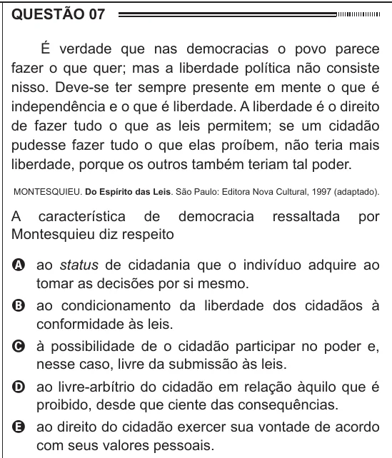

Texto extraído (pode conter ruído)

QUESTÃO 07  
É verdade que nas democracias o povo parece  
fazer o que quer; mas a liberdade política não consiste  
nisso. Deve-se ter sempre presente em mente o que é  
independência e o que é liberdade. A liberdade é o direito  
de fazer tudo o que as leis permitem; se um cidadão  
pudesse fazer tudo o que elas proíbem, não teria mais  
liberdade, porque os outros também teriam tal poder.  
MONTESQUIEU. Do Espírito das Leis. São Paulo: Editora Nova Cultural, 1997 (adaptado).  
A característica de democracia  
ressaltada  
por  
Montesquieu diz respeito  
A ao status de cidadania que o indivíduo adquire ao  
tomar as decisões por si mesmo.  
B ao condicionamento da liberdade dos cidadãos à  
conformidade às leis.  
C à possibilidade de o cidadão participar no poder e,  
nesse caso, livre da submissão às leis.  
D ao livre-arbítrio do cidadão em relação àquilo que é  
proibido, desde que ciente das consequências.  
E ao direito do cidadão exercer sua vontade de acordo  
com seus valores pessoais.

