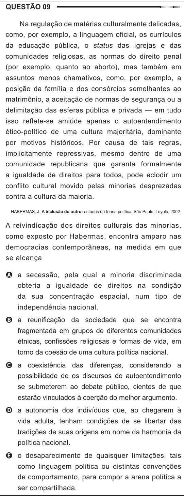

Texto extraído (pode conter ruído)

QUESTÃO 09  
Na regulação de matérias culturalmente delicadas,  
como, por exemplo, a linguagem oficial, os currículos  
da educação pública, o status das Igrejas e das  
comunidades religiosas, as normas do direito penal  
(por exemplo, quanto ao aborto), mas também em  
assuntos menos chamativos, como, por exemplo, a  
posição da família e dos consórcios semelhantes ao  
matrimônio, a aceitação de normas de segurança ou a  
delimitação das esferas pública e privada — em tudo  
isso reflete-se amiúde apenas o autoentendimento  
ético-político de uma cultura majoritária, dominante  
por motivos históricos. Por causa de tais regras,  
implicitamente repressivas, mesmo dentro de uma  
comunidade republicana que garanta formalmente  
a igualdade de direitos para todos, pode eclodir um  
conflito cultural movido pelas minorias desprezadas  
contra a cultura da maioria.  
HABERMAS, J. A inclusão do outro: estudos de teoria política. São Paulo: Loyola, 2002.  
A reivindicação dos direitos culturais das minorias,  
como exposto por Habermas, encontra amparo nas  
democracias contemporâneas, na medida em que  
se alcança  
A a secessão, pela qual a minoria discriminada  
obteria a igualdade de direitos na condição  
da sua concentração espacial, num tipo de  
independência nacional.  
B a reunificação da sociedade que se encontra  
fragmentada em grupos de diferentes comunidades  
étnicas, confissões religiosas e formas de vida, em  
torno da coesão de uma cultura política nacional.  
C a coexistência das diferenças, considerando a  
possibilidade de os discursos de autoentendimento  
se submeterem ao debate público, cientes de que  
estarão vinculados à coerção do melhor argumento.  
D a autonomia dos indivíduos que, ao chegarem à  
vida adulta, tenham condições de se libertar das  
tradições de suas origens em nome da harmonia da  
política nacional.  
E o desaparecimento de quaisquer limitações, tais  
como linguagem política ou distintas convenções  
de comportamento, para compor a arena política a  
ser compartilhada.

