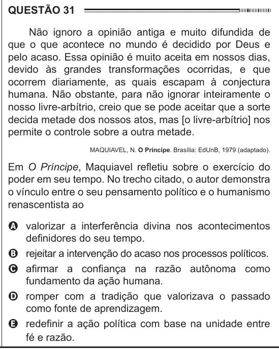

Texto extraído (pode conter ruído)

QUESTÃO 31  
Não ignoro a opinião antiga e muito difundida de  
que o que acontece no mundo é decidido por Deus e  
pelo acaso. Essa opinião é muito aceita em nossos dias,  
devido às grandes transformações ocorridas, e que  
ocorrem diariamente, as quais escapam à conjectura  
humana. Não obstante, para não ignorar inteiramente o  
nosso livre-arbítrio, creio que se pode aceitar que a sorte  
decida metade dos nossos atos, mas [o livre-arbítrio] nos  
permite o controle sobre a outra metade.  
MAQUIAVEL, N. O Príncipe. Brasília: EdUnB, 1979 (adaptado).  
Em O Príncipe, Maquiavel refletiu sobre o exercício do  
poder em seu tempo. No trecho citado, o autor demonstra  
o vínculo entre o seu pensamento político e o humanismo  
renascentista ao  
A valorizar a interferência divina nos acontecimentos  
definidores do seu tempo.  
B rejeitar a intervenção do acaso nos processos políticos.  
C afirmar a confiança na razão autônoma como  
fundamento da ação humana.  
D romper com a tradição que valorizava o passado  
como fonte de aprendizagem.  
E redefinir a ação política com base na unidade entre  
fé e razão.

