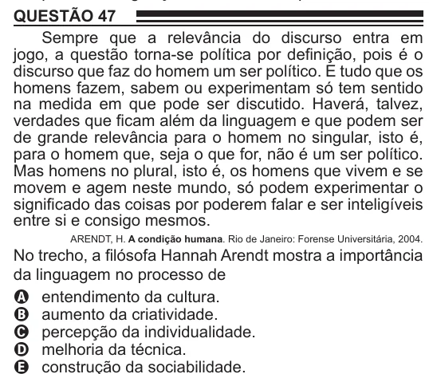

Texto extraído (pode conter ruído)

QUESTÃO 47  
Sempre que a relevância do discurso entra em  
jogo, a questão torna-se política por definição, pois é o  
discurso que faz do homem um ser político. E tudo que os  
homens fazem, sabem ou experimentam só tem sentido  
na medida em que pode ser discutido. Haverá, talvez,  
verdades que ficam além da linguagem e que podem ser  
de grande relevância para o homem no singular, isto é,  
para o homem que, seja o que for, não é um ser político.  
Mas homens no plural, isto é, os homens que vivem e se  
movem e agem neste mundo, só podem experimentar o  
significado das coisas por poderem falar e ser inteligíveis  
entre si e consigo mesmos.  
ARENDT, H. A condição humana. Rio de Janeiro: Forense Universitária, 2004.  
No trecho, a filósofa Hannah Arendt mostra a importância  
da linguagem no processo de  
A entendimento da cultura.  
B aumento da criatividade.  
C percepção da individualidade.  
D melhoria da técnica.

