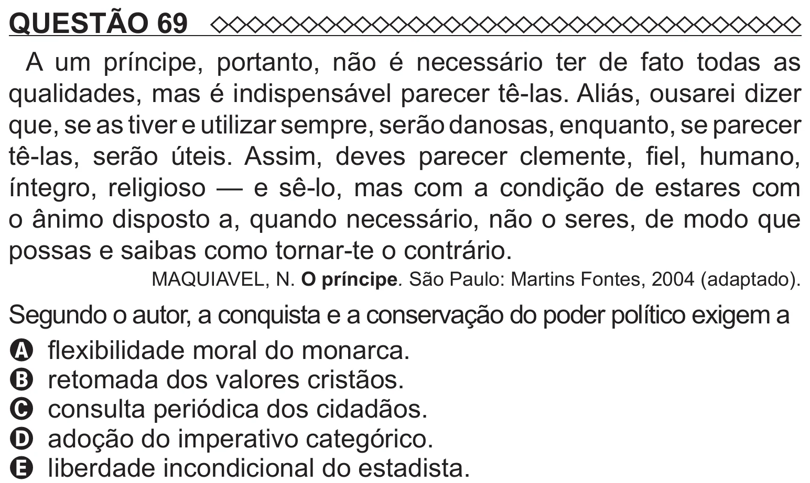

Texto extraído (pode conter ruído)

QUESTÃO 69  
A um príncipe, portanto, não é necessário ter de fato todas as  
qualidades, mas é indispensável parecer tê-las. Aliás, ousarei dizer  
que, se as tiver e utilizar sempre, serão danosas, enquanto, se parecer  
tê-las, serão úteis. Assim, deves parecer clemente, fiel, humano,  
íntegro, religioso — e sê-lo, mas com a condição de estares com  
o ânimo disposto a, quando necessário, não o seres, de modo que  
possas e saibas como tornar-te o contrário.  
MAQUIAVEL, N. O príncipe. São Paulo: Martins Fontes, 2004 (adaptado).  
Segundo o autor, a conquista e a conservação do poder político exigem a  
A flexibilidade moral do monarca.  
B retomada dos valores cristãos.  
C consulta periódica dos cidadãos.  
D adoção do imperativo categórico.

