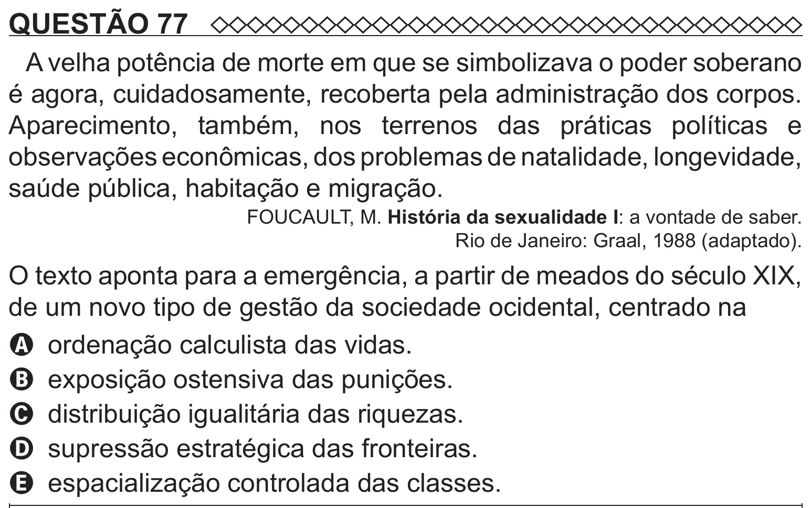

Texto extraído (pode conter ruído)

QUESTÃO 77  
A velha potência de morte em que se simbolizava o poder soberano  
é agora, cuidadosamente, recoberta pela administração dos corpos.  
Aparecimento, também, nos terrenos das práticas políticas e  
observações econômicas, dos problemas de natalidade, longevidade,  
saúde pública, habitação e migração.  
FOUCAULT, M. História da sexualidade I: a vontade de saber.  
Rio de Janeiro: Graal, 1988 (adaptado).  
O texto aponta para a emergência, a partir de meados do século XIX,  
de um novo tipo de gestão da sociedade ocidental, centrado na  
A ordenação calculista das vidas.  
B exposição ostensiva das punições.  
C distribuição igualitária das riquezas.  
D supressão estratégica das fronteiras.  
E espacialização controlada das classes.

