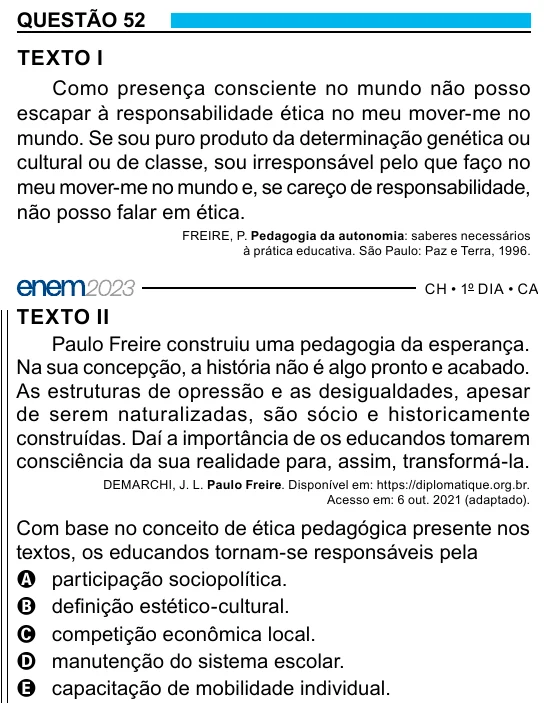

Texto extraído (pode conter ruído)

QUESTÃO 52  
TEXTO I  
Como presença consciente no mundo não posso  
escapar à responsabilidade ética no meu mover-me no  
mundo. Se sou puro produto da determinação genética ou  
cultural ou de classe, sou irresponsável pelo que faço no  
meu mover-me no mundo e, se careço de responsabilidade,  
não posso falar em ética.  
FREIRE, P. Pedagogia da autonomia: saberes necessários  
à prática educativa. São Paulo: Paz e Terra, 1996.  
TEXTO II  
Paulo Freire construiu uma pedagogia da esperança.  
Na sua concepção, a história não é algo pronto e acabado.  
As estruturas de opressão e as desigualdades, apesar  
de serem naturalizadas, são sócio e historicamente  
construídas. Daí a importância de os educandos tomarem  
consciência da sua realidade para, assim, transformá-la.  
DEMARCHI, J. L. Paulo Freire. Disponível em: https://diplomatique.org.br.  
Acesso em: 6 out. 2021 (adaptado).  
Com base no conceito de ética pedagógica presente nos  
textos, os educandos tornam-se responsáveis pela  
A participação sociopolítica.  
B definição estético-cultural.  
C competição econômica local.  
D manutenção do sistema escolar.  
E capacitação de mobilidade individual.

