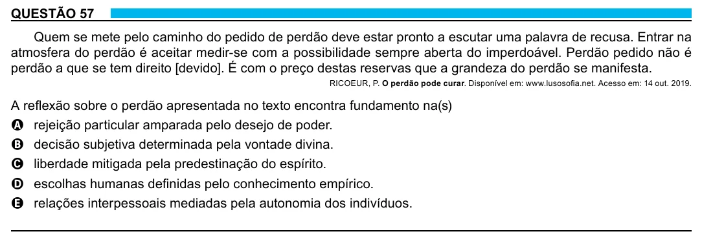

Texto extraído (pode conter ruído)

QUESTÃO 57  
Quem se mete pelo caminho do pedido de perdão deve estar pronto a escutar uma palavra de recusa. Entrar na  
atmosfera do perdão é aceitar medir-se com a possibilidade sempre aberta do imperdoável. Perdão pedido não é  
perdão a que se tem direito [devido]. É com o preço destas reservas que a grandeza do perdão se manifesta.  
RICOEUR, P. O perdão pode curar. Disponível em: www.lusosofia.net. Acesso em: 14 out. 2019.  
A reflexão sobre o perdão apresentada no texto encontra fundamento na(s)  
A rejeição particular amparada pelo desejo de poder.  
B decisão subjetiva determinada pela vontade divina.  
C liberdade mitigada pela predestinação do espírito.  
D escolhas humanas definidas pelo conhecimento empírico.  
E relações interpessoais mediadas pela autonomia dos indivíduos.  
22

