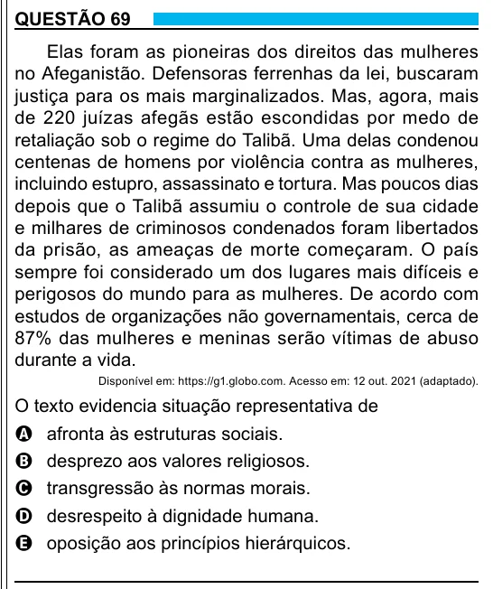

Texto extraído (pode conter ruído)

QUESTÃO 69  
Elas foram as pioneiras dos direitos das mulheres  
no Afeganistão. Defensoras ferrenhas da lei, buscaram  
justiça para os mais marginalizados. Mas, agora, mais  
de 220 juízas afegãs estão escondidas por medo de  
retaliação sob o regime do Talibã. Uma delas condenou  
centenas de homens por violência contra as mulheres,  
incluindo estupro, assassinato e tortura. Mas poucos dias  
depois que o Talibã assumiu o controle de sua cidade  
e milhares de criminosos condenados foram libertados  
da prisão, as ameaças de morte começaram. O país  
sempre foi considerado um dos lugares mais difíceis e  
perigosos do mundo para as mulheres. De acordo com  
estudos de organizações não governamentais, cerca de  
87% das mulheres e meninas serão vítimas de abuso  
durante a vida.  
Disponível em: https://g1.globo.com. Acesso em: 12 out. 2021 (adaptado).  
O texto evidencia situação representativa de  
A afronta às estruturas sociais.  
B desprezo aos valores religiosos.  
C transgressão às normas morais.  
D desrespeito à dignidade humana.  
E oposição aos princípios hierárquicos.  
25

