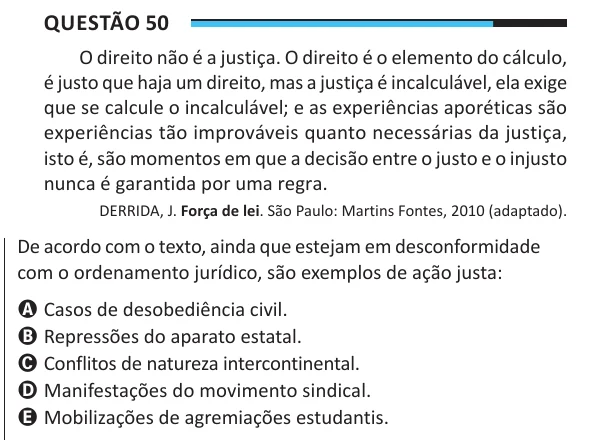

Texto extraído (pode conter ruído)

Questão 50  
O direito não é a justiça. O direito é o elemento do cálculo,  
é justo que haja um direito, mas a justiça é incalculável, ela exige  
que se calcule o incalculável; e as experiências aporéticas são  
experiências tão improváveis quanto necessárias da justiça,  
isto é, são momentos em que a decisão entre o justo e o injusto  
nunca é garantida por uma regra.  
DERRIDA, J. Força de lei. São Paulo: Martins Fontes, 2010 (adaptado).  
De acordo com o texto, ainda que estejam em desconformidade  
com o ordenamento jurídico, são exemplos de ação justa:  
A Casos de desobediência civil.  
B Repressões do aparato estatal.  
C Conflitos de natureza intercontinental.  
D Manifestações do movimento sindical.  
E Mobilizações de agremiações estudantis.

