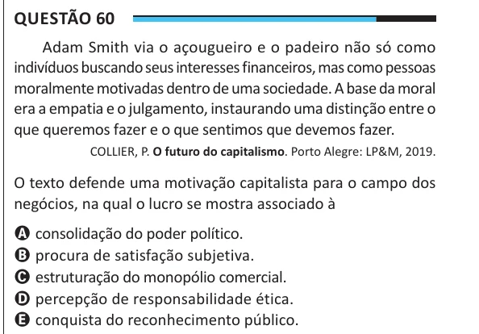

Texto extraído (pode conter ruído)

Questão 60  
Adam Smith via o açougueiro e o padeiro não só como  
indivíduos buscando seus interesses financeiros, mas como pessoas  
moralmente motivadas dentro de uma sociedade. A base da moral  
era a empatia e o julgamento, instaurando uma distinção entre o  
que queremos fazer e o que sentimos que devemos fazer.  
COLLIER, P. O futuro do capitalismo. Porto Alegre: LP&M, 2019.  
O texto defende uma motivação capitalista para o campo dos  
negócios, na qual o lucro se mostra associado à  
A consolidação do poder político.  
B procura de satisfação subjetiva.  
C estruturação do monopólio comercial.  
D percepção de responsabilidade ética.  
E conquista do reconhecimento público.

