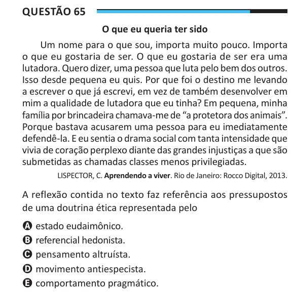

Texto extraído (pode conter ruído)

Questão 65  
O que eu queria ter sido  
Um nome para o que sou, importa muito pouco. Importa  
o que eu gostaria de ser. O que eu gostaria de ser era uma  
lutadora. Quero dizer, uma pessoa que luta pelo bem dos outros.  
Isso desde pequena eu quis. Por que foi o destino me levando  
a escrever o que já escrevi, em vez de também desenvolver em  
mim a qualidade de lutadora que eu tinha? Em pequena, minha  
família por brincadeira chamava-me de “a protetora dos animais”.  
Porque bastava acusarem uma pessoa para eu imediatamente  
defendê-la. E eu sentia o drama social com tanta intensidade que  
vivia de coração perplexo diante das grandes injustiças a que são  
submetidas as chamadas classes menos privilegiadas.  
LISPECTOR, C. Aprendendo a viver. Rio de Janeiro: Rocco Digital, 2013.  
A reflexão contida no texto faz referência aos pressupostos  
de uma doutrina ética representada pelo  
A estado eudaimônico.  
B referencial hedonista.  
C pensamento altruísta.  
D movimento antiespecista.  
E comportamento pragmático.

