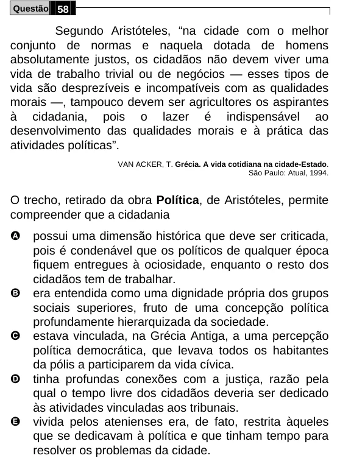

Texto extraído (pode conter ruído)

Questão 58  
Segundo Aristóteles, “na cidade com o melhor  
conjunto de normas e naquela dotada de homens  
absolutamente justos, os cidadãos não devem viver uma  
vida de trabalho trivial ou de negócios — esses tipos de  
vida são desprezíveis e incompatíveis com as qualidades  
morais —, tampouco devem ser agricultores os aspirantes  
à cidadania, pois o lazer é indispensável ao  
desenvolvimento das qualidades morais e à prática das  
atividades políticas”.  
VAN ACKER, T. Grécia. A vida cotidiana na cidade-Estado.  
São Paulo: Atual, 1994.  
O trecho, retirado da obra Política, de Aristóteles, permite  
compreender que a cidadania  
A  
possui uma dimensão histórica que deve ser criticada,  
pois é condenável que os políticos de qualquer época  
fiquem entregues à ociosidade, enquanto o resto dos  
cidadãos tem de trabalhar.  
B  
era entendida como uma dignidade própria dos grupos  
sociais superiores, fruto de uma concepção política  
profundamente hierarquizada da sociedade.  
C  
estava vinculada, na Grécia Antiga, a uma percepção  
política democrática, que levava todos os habitantes  
da pólis a participarem da vida cívica.  
D  
tinha profundas conexões com a justiça, razão pela  
qual o tempo livre dos cidadãos deveria ser dedicado  
às atividades vinculadas aos tribunais.  
E  
vivida pelos atenienses era, de fato, restrita àqueles  
que se dedicavam à política e que tinham tempo para  
resolver os problemas da cidade.

