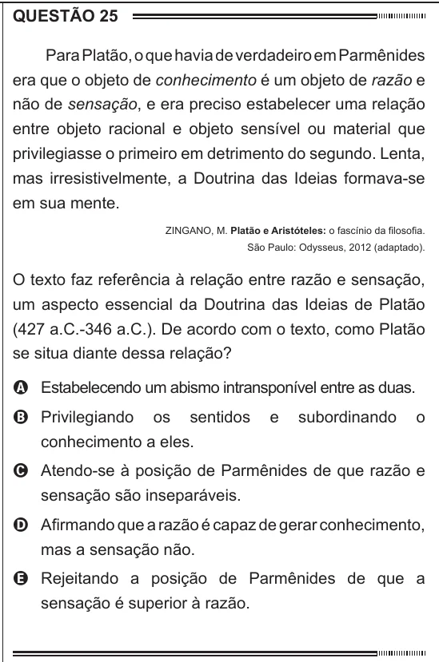

Texto extraído (pode conter ruído)

QUESTÃO 25  
Para Platão, o que havia de verdadeiro em Parmênides  
era que o objeto de conhecimento é um objeto de razão e  
não de sensação, e era preciso estabelecer uma relação  
entre objeto racional e objeto sensível ou material que  
privilegiasse o primeiro em detrimento do segundo. Lenta,  
mas irresistivelmente, a Doutrina das Ideias formava-se  
em sua mente.  
ZINGANO, M. Platão e Aristóteles: o fascínio da filosofia.  
São Paulo: Odysseus, 2012 (adaptado).  
O texto faz referência à relação entre razão e sensação,  
um aspecto essencial da Doutrina das Ideias de Platão  
(427 a.C.-346 a.C.). De acordo com o texto, como Platão  
se situa diante dessa relação?  
A Estabelecendo um abismo intransponível entre as duas.  
B Privilegiando  
os  
sentidos  
e  
subordinando  
o  
conhecimento a eles.  
C Atendo-se à posição de Parmênides de que razão e  
sensação são inseparáveis.  
D Afirmando que a razão é capaz de gerar conhecimento,  
mas a sensação não.  
E Rejeitando a posição de Parmênides de que a  
sensação é superior à razão.

