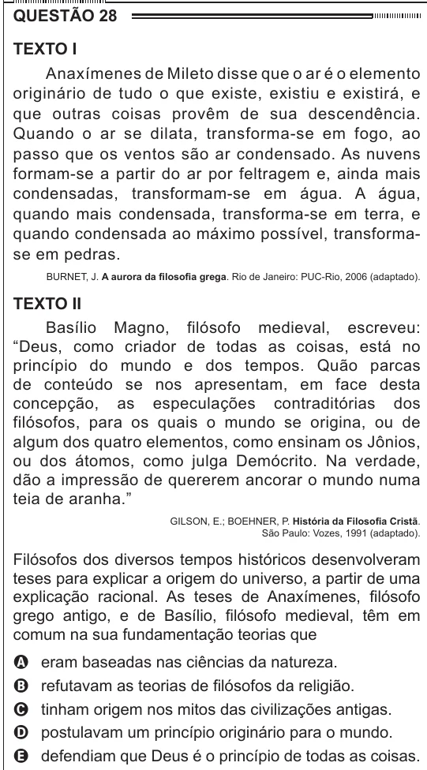

Texto extraído (pode conter ruído)

QUESTÃO 28  
Texto I  
Anaxímenes de Mileto disse que o ar é o elemento  
originário de tudo o que existe, existiu e existirá, e  
que outras coisas provêm de sua descendência.  
Quando o ar se dilata, transforma-se em fogo, ao  
passo que os ventos são ar condensado. As nuvens  
formam-se a partir do ar por feltragem e, ainda mais  
condensadas, transformam-se em água. A água,  
quando mais condensada, transforma-se em terra, e  
quando condensada ao máximo possível, transforma-  
se em pedras.  
BURNET, J. A aurora da filosofia grega. Rio de Janeiro: PUC-Rio, 2006 (adaptado).  
Texto II  
Basílio Magno, filósofo medieval, escreveu:  
“Deus, como criador de todas as coisas, está no  
princípio do mundo e dos tempos. Quão parcas  
de conteúdo se nos apresentam, em face desta  
concepção, as especulações contraditórias dos  
filósofos, para os quais o mundo se origina, ou de  
algum dos quatro elementos, como ensinam os Jônios,  
ou dos átomos, como julga Demócrito. Na verdade,  
dão a impressão de quererem ancorar o mundo numa  
teia de aranha.”  
GILSON, E.; BOEHNER, P. História da Filosofia Cristã.  
São Paulo: Vozes, 1991 (adaptado).  
Filósofos dos diversos tempos históricos desenvolveram  
teses para explicar a origem do universo, a partir de uma  
explicação racional. As teses de Anaxímenes, filósofo  
grego antigo, e de Basílio, filósofo medieval, têm em  
comum na sua fundamentação teorias que  
eram baseadas nas ciências da natureza.  
A  
refutavam as teorias de filósofos da religião.  
B  
C  
tinham origem nos mitos das civilizações antigas.  
postulavam um princípio originário para o mundo.  
D  
defendiam que Deus é o princípio de todas as coisas.  
E

