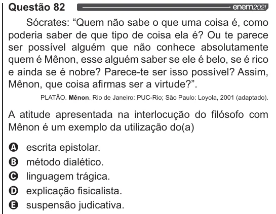

Texto extraído (pode conter ruído)

Questão 82  
Sócrates: “Quem não sabe o que uma coisa é, como  
poderia saber de que tipo de coisa ela é? Ou te parece  
ser possível alguém que não conhece absolutamente  
quem é Mênon, esse alguém saber se ele é belo, se é rico  
e ainda se é nobre? Parece-te ser isso possível? Assim,  
Mênon, que coisa afirmas ser a virtude?”.  
PLATÃO. Mênon. Rio de Janeiro: PUC-Rio; São Paulo: Loyola, 2001 (adaptado).  
A atitude apresentada na interlocução do filósofo com  
Mênon é um exemplo da utilização do(a)  
OQ escrita epistolar.  
O método dialético.  
O linguagem trágica.  
O explicação fisicalista.  
& suspensão judicativa.

