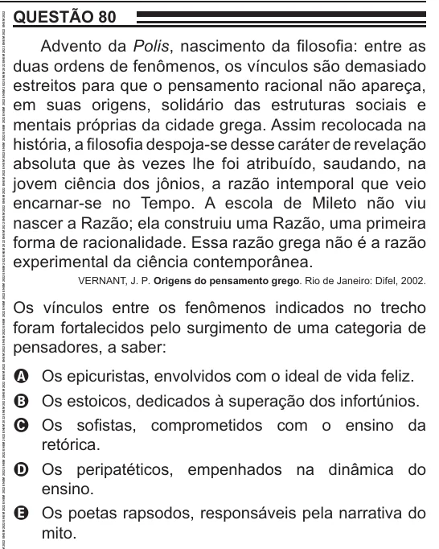

Texto extraído (pode conter ruído)

QUESTÃO 80  
Advento da Polis, nascimento da filosofia: entre as  
duas ordens de fenômenos, os vínculos são demasiado  
estreitos para que o pensamento racional não apareça,  
em suas origens, solidário das estruturas sociais e  
mentais próprias da cidade grega. Assim recolocada na  
história, a filosofia despoja-se desse caráter de revelação  
absoluta que às vezes lhe foi atribuído, saudando, na  
jovem ciência dos jônios, a razão intemporal que veio  
encarnar-se no Tempo. A escola de Mileto não viu  
nascer a Razão; ela construiu uma Razão, uma primeira  
forma de racionalidade. Essa razão grega não é a razão  
experimental da ciência contemporânea.  
VERNANT, J. P. Origens do pensamento grego. Rio de Janeiro: Difel, 2002.  
Os vínculos entre os fenômenos indicados no trecho  
foram fortalecidos pelo surgimento de uma categoria de  
pensadores, a saber:  
A Os epicuristas, envolvidos com o ideal de vida feliz.  
B Os estoicos, dedicados à superação dos infortúnios.  
C Os sofistas, comprometidos com o ensino da  
retórica.  
D Os peripatéticos, empenhados na dinâmica do  
ensino.  
E Os poetas rapsodos, responsáveis pela narrativa do  
mito.

