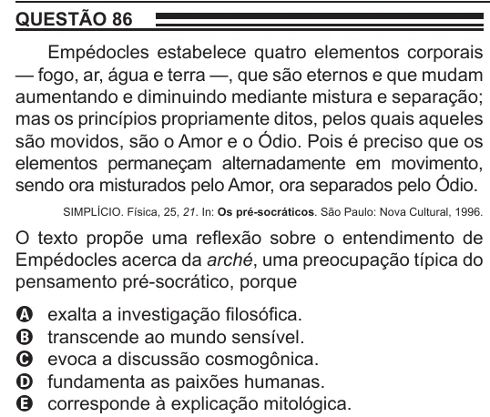

Texto extraído (pode conter ruído)

QUESTÃO 86  
Empédocles estabelece quatro elementos corporais  
— fogo, ar, água e terra —, que são eternos e que mudam  
aumentando e diminuindo mediante mistura e separação;  
mas os princípios propriamente ditos, pelos quais aqueles  
são movidos, são o Amor e o Ódio. Pois é preciso que os  
elementos permaneçam alternadamente em movimento,  
sendo ora misturados pelo Amor, ora separados pelo Ódio.  
SIMPLÍCIO. Física, 25, 21. In: Os pré-socráticos. São Paulo: Nova Cultural, 1996.  
O texto propõe uma reflexão sobre o entendimento de  
Empédocles acerca da arché, uma preocupação típica do  
pensamento pré-socrático, porque  
A  
exalta a investigação filosófica.  
transcende ao mundo sensível.  
B  
evoca a discussão cosmogônica.  
C  
fundamenta as paixões humanas.  
D  
corresponde à explicação mitológica.  
E

