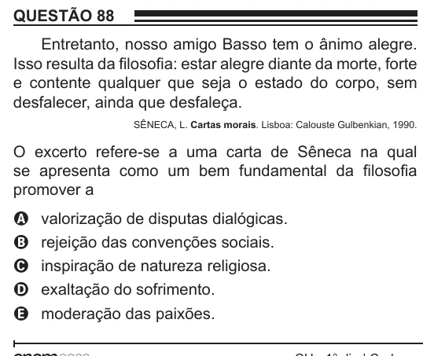

Texto extraído (pode conter ruído)

QUESTÃO 88  
Entretanto, nosso amigo Basso tem o ânimo alegre.  
Isso resulta da filosofia: estar alegre diante da morte, forte  
e contente qualquer que seja o estado do corpo, sem  
desfalecer, ainda que desfaleça.  
SÊNECA, L. Cartas morais. Lisboa: Calouste Gulbenkian, 1990.  
O excerto refere-se a uma carta de Sêneca na qual  
se apresenta como um bem fundamental da filosofia  
promover a  
A  
valorização de disputas dialógicas.  
rejeição das convenções sociais.  
B  
inspiração de natureza religiosa.  
C  
exaltação do sofrimento.  
D  
moderação das paixões.  
E

