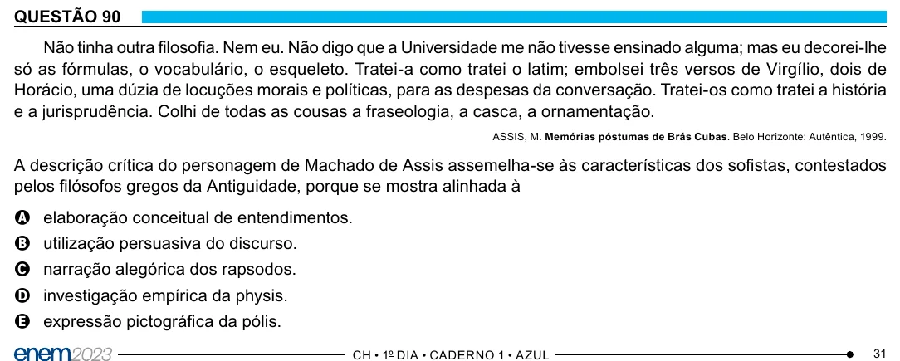

Texto extraído (pode conter ruído)

QUESTÃO 90  
Não tinha outra filosofia. Nem eu. Não digo que a Universidade me não tivesse ensinado alguma; mas eu decorei-lhe  
só as fórmulas, o vocabulário, o esqueleto. Tratei-a como tratei o latim; embolsei três versos de Virgílio, dois de  
Horácio, uma dúzia de locuções morais e políticas, para as despesas da conversação. Tratei-os como tratei a história  
e a jurisprudência. Colhi de todas as cousas a fraseologia, a casca, a ornamentação.  
ASSIS, M. Memórias póstumas de Brás Cubas. Belo Horizonte: Autêntica, 1999.  
A descrição crítica do personagem de Machado de Assis assemelha-se às características dos sofistas, contestados  
pelos filósofos gregos da Antiguidade, porque se mostra alinhada à  
A elaboração conceitual de entendimentos.  
B utilização persuasiva do discurso.  
C narração alegórica dos rapsodos.  
D investigação empírica da physis.  
E expressão pictográfica da pólis.  
31

