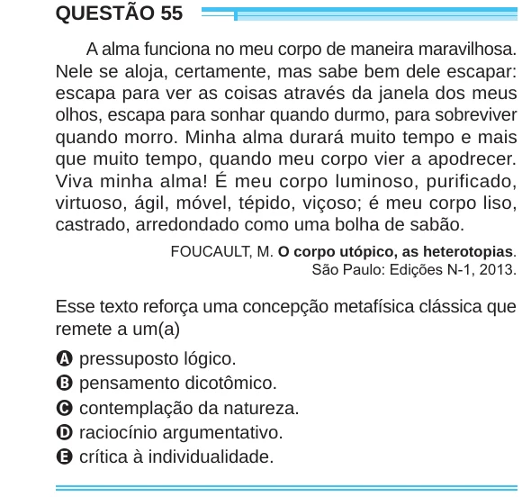

Texto extraído (pode conter ruído)

QUESTÃO 55  
A alma funciona no meu corpo de maneira maravilhosa.  
Nele se aloja, certamente, mas sabe bem dele escapar:  
escapa para ver as coisas através da janela dos meus  
olhos, escapa para sonhar quando durmo, para sobreviver  
quando morro. Minha alma durará muito tempo e mais  
que muito tempo, quando meu corpo vier a apodrecer.  
Viva minha alma! É meu corpo luminoso, purificado,  
virtuoso, ágil, móvel, tépido, viçoso; é meu corpo liso,  
castrado, arredondado como uma bolha de sabão.  
FOUCAULT, M. O corpo utópico, as heterotopias.  
São Paulo: Edições N-1, 2013.  
Esse texto reforça uma concepção metafísica clássica que  
remete a um(a)  
A pressuposto lógico.  
B pensamento dicotômico.  
C contemplação da natureza.  
D raciocínio argumentativo.  
E crítica à individualidade.

